## Hugo Fabian NC 0040 nl 17

## Tabla d herramientas
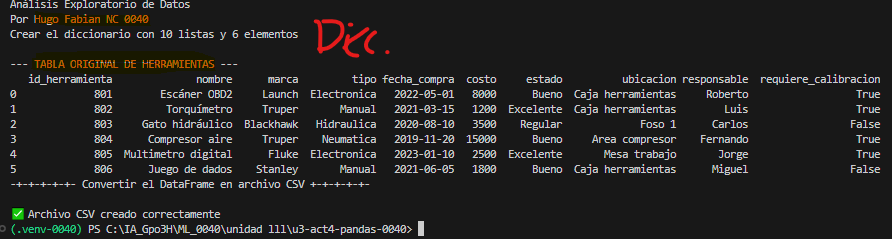
## Convertir el DataFrame en archivo CSV
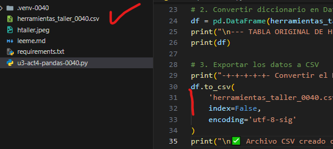
## datos del cvs-->
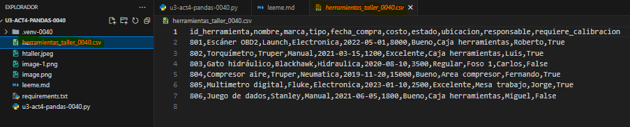
## leer los datos desde elarchivo csv
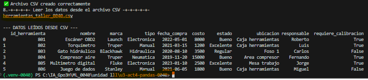
## Análisis Exploratorio de Datos
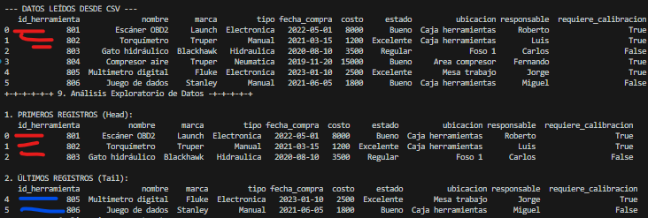
## Dimensiones y estructura
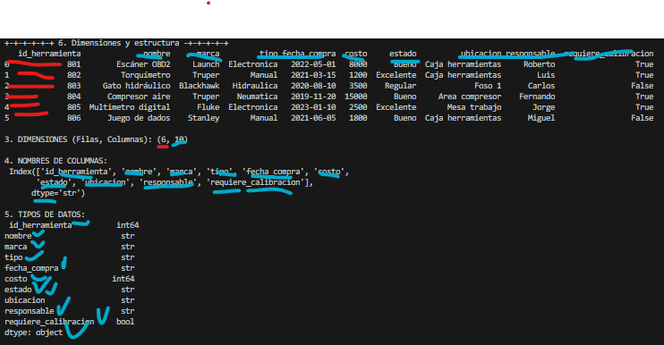
## estadisticas y limpieza
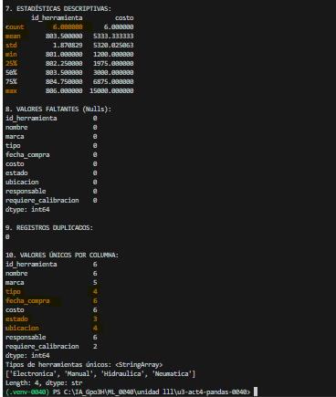
## 8 y 9 ordenamiento, filtrado y agrupacion
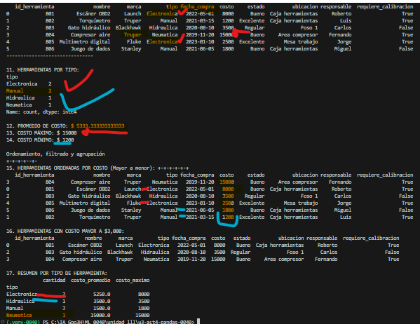
## grafica de barras
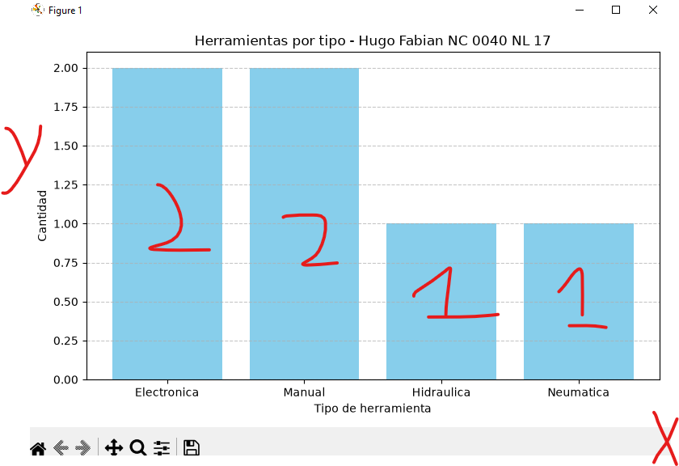
## grafica de barras
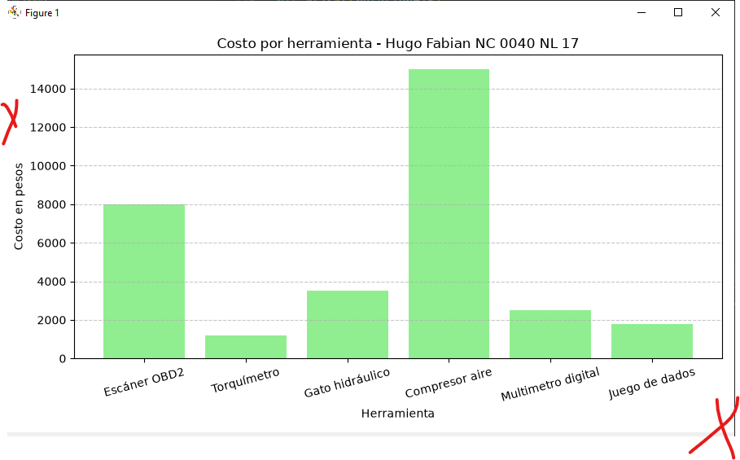
## Histograma
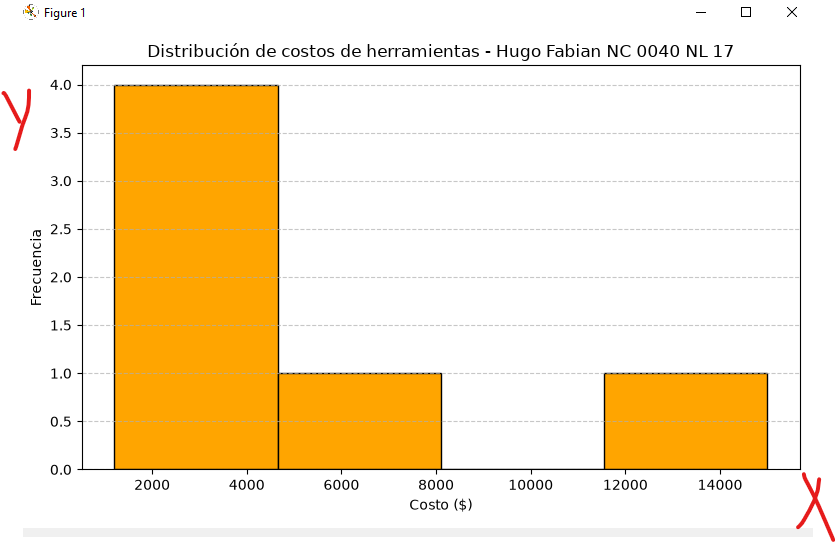
## Gráfica de dispersión
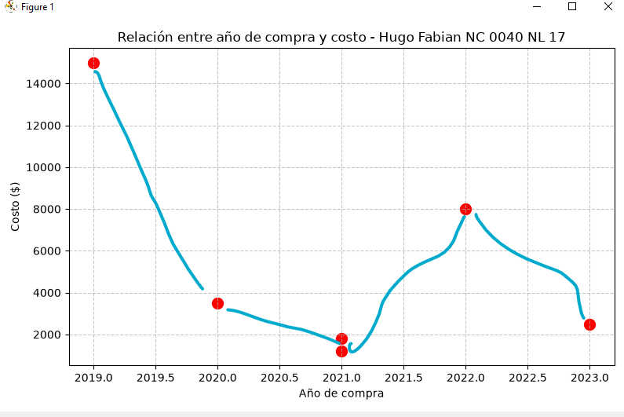
## Diagrama de caja
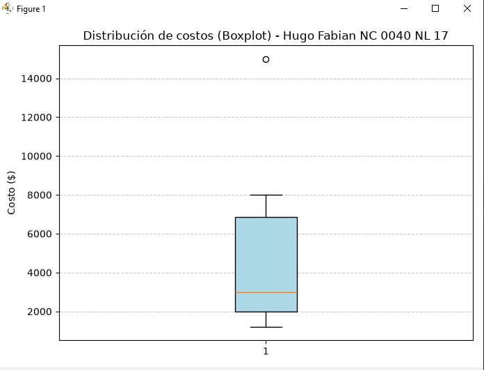
## Matriz de correlación
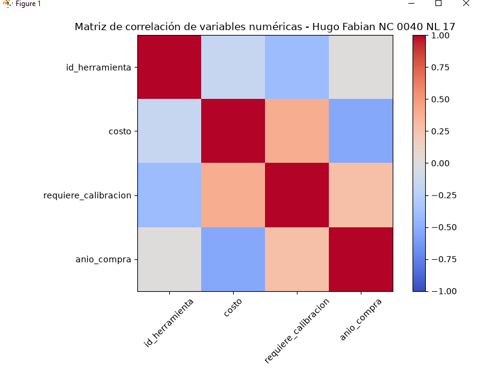